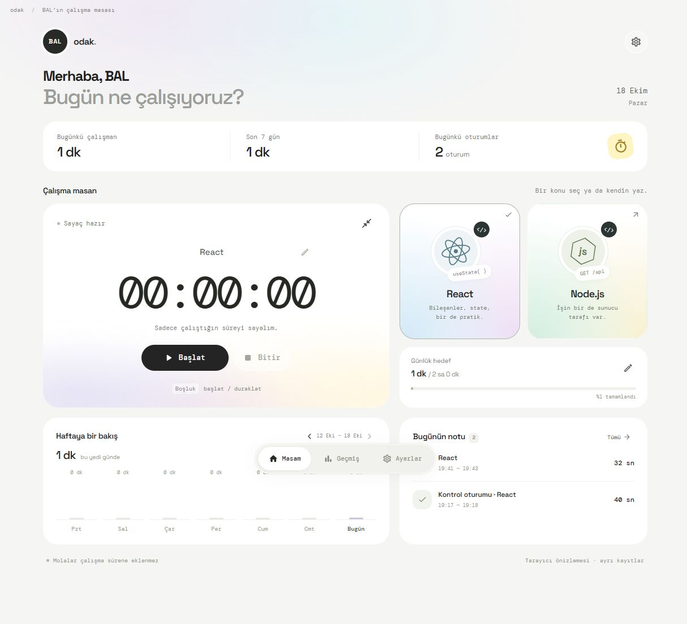

# Odak

React, TypeScript, Tailwind CSS, Material UI ve Electron ile geliştirilmiş yerel ders çalışma sayacı.

Bir tuşla çalışmaya başla, dikkatin dağıldığında duraklat. Oturumlarını ve günlük toplamlarını bilgisayarında tut.



_Ekran görüntüsündeki süreler tarayıcı önizlemesindeki deneme oturumlarına aittir._

## Kullanım

- React veya Node.js kartına tıkla ya da kendi konunu yaz, **Başlat** düğmesine bas.
- **Duraklat / Devam et** aynı oturumda süreyi biriktirir; mola sürelerini saymaz.
- **Bitir** oturumu geçmişe kaydeder.
- **Boşluk:** uygulama penceresinde başlat / duraklat. Yazı alanlarında normal yazmaya devam edebilirsin.
- **Ctrl + Alt + Boşluk:** başka uygulama açıkken de başlat / duraklat. Bu kısayol başka bir uygulamada kullanılıyorsa ayarlarda belirtilir.
- Sayaç kartının sağ üstündeki simge, her zaman üstte duran küçük pencereyi açar.
- Pencereyi kapatmak sayacı duraklatır ve uygulamayı sistem tepsisine gizler. Tepsi simgesine çift tıklayarak açabilirsin.
- Pencereyi küçültmek sayacı durdurmaz. Bilgisayar uykuya geçtiğinde veya ekran kilitlendiğinde otomatik duraklar.
- Sistem tepsisi menüsündeki **Çıkış**, uygulamayı tamamen kapatır.
- Ayarlardan günlük hedefi değiştirebilir, geçmişten günlük toplamlarını CSV olarak dışa aktarabilirsin.

## Kayıtlar

Masaüstü kayıtları `%APPDATA%\Odak\odak.json` içinde saklanır. Kesin yol ayarlarda görünür.
Kayıtlar atomik dosya değişimiyle yazılır; önceki sağlam dosya `.bak` olarak korunur.
Çalışma sırasında her 5 saniyede bir kontrol noktası yazılır. Beklenmedik kapanışta en fazla son 5 saniye kaybolabilir; uygulama kapalı kaldığı zamanı çalışma süresine eklemez.
Günlük toplamlar bilgisayarın yerel saat dilimine göre hesaplanır. Gece yarısını geçen süre ilgili günlere bölünür.
Tarayıcı önizlemesi ayrı bir localStorage deposu kullanır; masaüstü geçmişiyle paylaşılmaz.

## Geliştirme

Node.js 22.12 veya üzeri gerekir.

```powershell
npm install
npm run dev
```

Tarayıcı önizlemesi: http://127.0.0.1:5186

```powershell
npm run test
npm run build
npx --no-install install-electron
npm run desktop
```

## Windows paketi

```powershell
powershell -NoProfile -ExecutionPolicy Bypass -File scripts/generate-icon.ps1
npx --no-install install-electron
npm run package
powershell -NoProfile -ExecutionPolicy Bypass -File scripts/install-desktop.ps1
```

`release/1.1.1/Odak-1.1.1.exe` taşınabilir uygulamadır; Node.js veya geliştirme sunucusu gerektirmez.
Masaüstü kısayolu `release/1.1.1/win-unpacked/Odak.exe` dosyasını kullanır.
Sürümler ayrı klasörlere paketlenir; açık eski sürümün dosyalarının üzerine yazılmaz.
Uygulama ticari kod imzalama sertifikasıyla imzalanmamıştır.

Arayüz ve ana süreç derleme sırasında paketlenir. React ve MUI dahil npm paketleri bu nedenle `devDependencies` içindedir; dağıtılan EXE bunların kaynak dosyalarına ihtiyaç duymaz.

## Yapı

- `src/App.tsx`: BAL’ın çalışma masası, sayfalar ve pencere kontrolleri.
- `src/hooks/useStudyTimer.ts`: kayıt köprüsüne bağlantı ve sayaç işlemleri.
- `src/components/`: sayaç, konu kartları, haftalık grafik, oturum listesi, geçmiş ve ayarlar.
- `src/theme.ts`: Material UI renkleri, yazı tipleri ve ortak bileşen ayarları.
- `src/styles.css`: Tailwind katmanları ve arayüz tasarımı.
- `src/shared/engine.ts`: süre hesabı, günlere bölme, kayıt doğrulama ve CSV.
- `electron/main.ts`: masaüstü pencere, kısayol, sistem tepsisi, uyku ve dosya işlemleri.
- `electron/preload.ts`: sınırlı ve tipli IPC köprüsü.
- `electron/storage.ts`: atomik kayıt ve bozuk dosyadan kurtarma.
- `tests/`: süre ve disk kaydı davranış testleri.

Kod biçimini korumak için `npm run format`, kontrol etmek için `npm run format:check` kullanılır.
İsim arayüzde **BAL** olarak yer alır; konu kartları React ve Node.js çalışmalarına göre düzenlenmiştir.
Tipografide portföydeki **Space Grotesk** ve **DM Mono** kullanılır. Font dosyaları uygulamaya dahildir; çevrimdışı çalışır. Tailwind ve Material UI aynı font değişkenlerini paylaşır.
